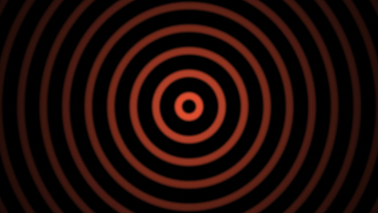

# Audio-Reactive Pulse

Rings that expand and shift color with the level of an audio input.

The preview is driven by a synthetic test signal, not by music.

## Use

Drag `audio_reactive_pulse.tox` into your TouchDesigner project. It listens to the default audio input device through the `audio_in` CHOP. To use another source, connect it to `analyze` instead.

## Parameters

| Parameter | Default | Effect |
| --- | --- | --- |
| Gain | 4.0 | Multiplies the audio level before it reaches the shader |

## Output

`out1`: a 1280×720 TOP.

## Tested

TouchDesigner 2025.33230 on Windows 11. The `.tox` loads, the shader compiles, and the output responds to a test signal. It has not yet been tested with a live microphone or line input.

## Rebuild from source

1. Open `scripts/build_audio_reactive_pulse.py` and set `SHADER_PATH` and `TOX_PATH`.
2. In TouchDesigner, paste the script into a Text DAT.
3. Right-click the DAT and choose Run Script.

- Shader: [`shaders/audio_reactive_pulse.frag`](../../shaders/audio_reactive_pulse.frag)
- Build script: [`scripts/build_audio_reactive_pulse.py`](../../scripts/build_audio_reactive_pulse.py)
